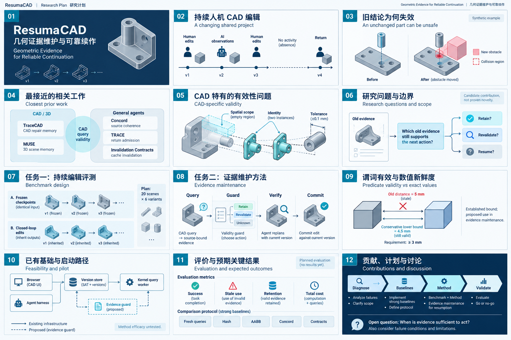
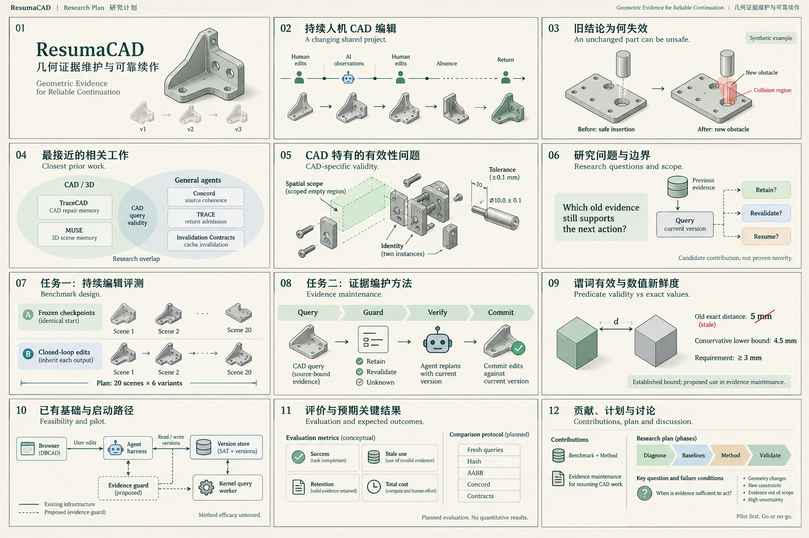
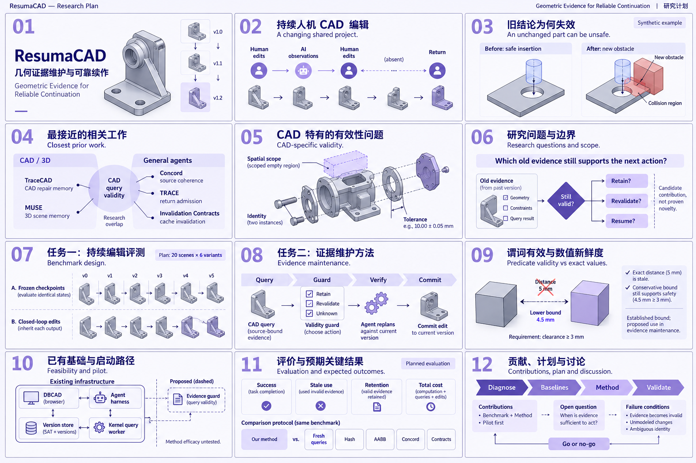
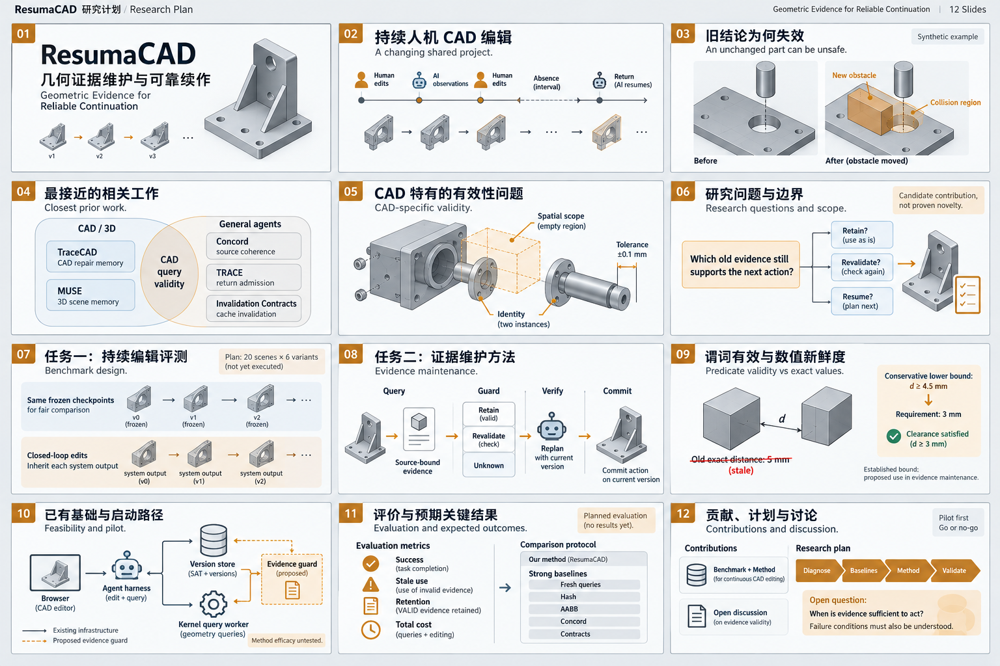

# ResumaCAD 开题汇报：四套风格预览

这是最终 PPT 制作前的风格选择材料。每套包含同一份 12 页研究计划的缩略预览，按 3 列 × 4 行浏览。图像通过维护者指定的 image-generation-bridge 调用 `gpt-image-2.5-flare` 生成。

预览板是生成式视觉示意，不是可直接放映的 12 页 PPT。缩略图块比例、小字、机械示意和简化架构不能充当实验依据；选定方案后，最终用可编辑文本和核对过的图示重排成 **12 页、16:9、1920×1080 逐页渲染**。

内容权威：[12 页底稿与讲解备注](../../../docs/research/PROPOSAL_SLIDES.md)；文献与判断：[选题覆盖复核](../../../docs/research/NOVELTY_AUDIT_20261026.md)；可追溯提示词：[请求模板](../../../docs/research/slide-preview-prompts.json)。

## A 深海蓝 / Navy & Cyan

冷白底、海军蓝、青色强调，适合工程与系统方法汇报。

## B 松石绿 / Pine & Sand

暖象牙白、深松绿、灰绿，偏期刊式编排与清淡学术风格。

## C 靛紫 / Indigo & Lilac

近白、靛紫、淡紫，偏计算机会议风格与结构化图示。

## D 石墨橙 / Graphite & Amber

灰白、石墨色、琥珀注释，偏机械技术报告与证据标注。

## 生成与校对说明

维护者将最初模型名 `image-2.5-flare` 更正为 `gpt-image-2.5-flare`。初次错误模型请求遭拒；随后出现过传输超时和参考图请求的 TLS 失败。没有在未告知的情况下改用另一模型。部分风格重新生成以纠正文献域标签和自动添加的时间计划；只保留经过视觉审阅的最终四板。最后两套生成增加了单次传输等待时间，未改动技能脚本、应用依赖或服务配置。

`preview-manifest.json` 记录最终文件、尺寸与摘要；接口未提供可核验的费用/用量汇总，因此不将失败调用视为免费，也不虚报生成成本。密钥、原始接口响应、日志和中间图片不纳入本提交。

状态：**等待维护者选定风格，再制作最终 PPT**。
