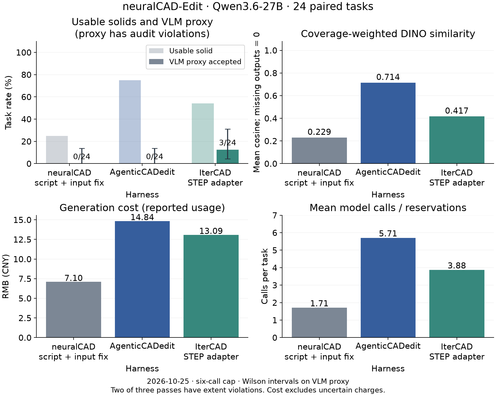
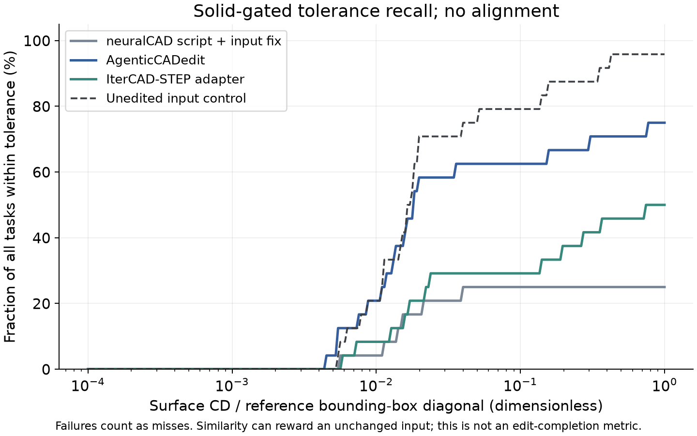
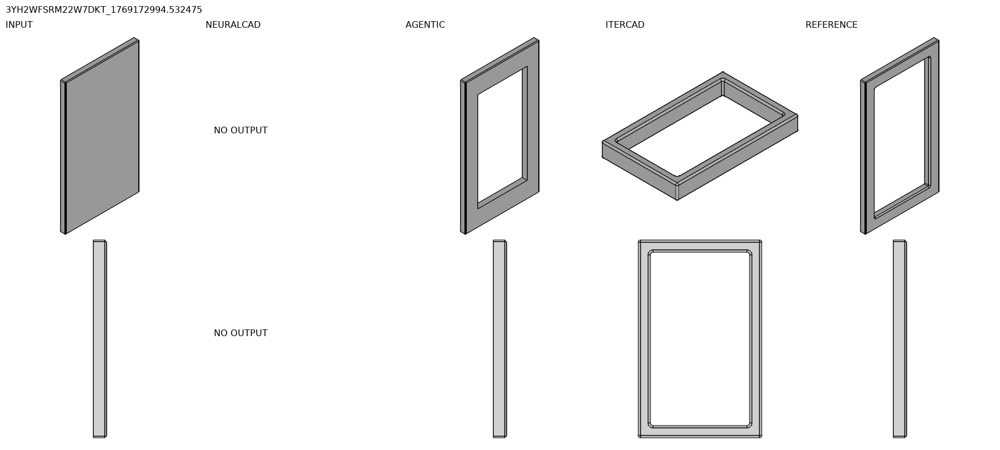
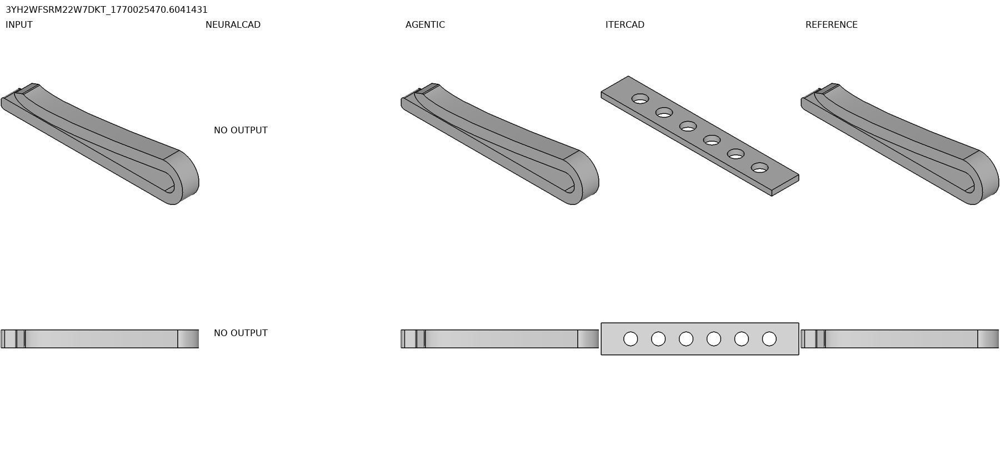
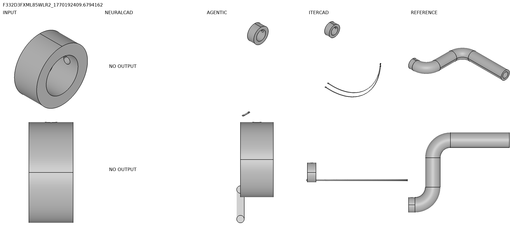
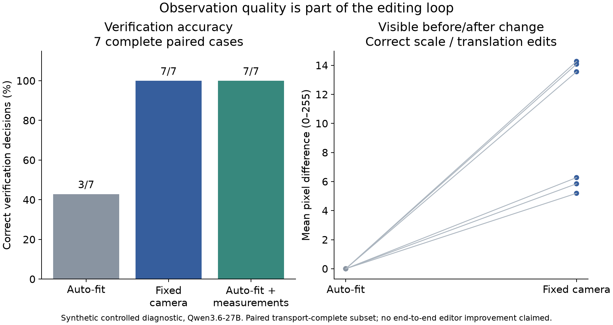

# InferraCAD 本轮实验报告

> 归档说明（2026-10-26）：实验登记与精选文本指标见 [EXP-001](../../experiments/exp-001-three-harness/README.md)。下列图片/PDF为本地忽略产物，克隆不会携带；原始结果和评分口径未修改。

2026-10-25 · 原生 AI 编辑接入与三 harness 对照 · 本机 Mac ARM64

## 1. 本轮交付和结论边界

DBCAD 已接入可用的自然语言编辑闭环：检查模型、调用 ACIS 命令、查看三视图、修正或撤销，最后生成可应用的预览。真实底板通孔任务和后续平移任务已运行；应用前正式版本不变，已有版本上的编辑支持应用、撤销与重做。

正式比较完成 **24 个请求 × 三方法 = 72 次运行**，是 neuralCAD-Edit 全部 192 请求的分层子集。按可复查的工程交付指标——实体可用率、全任务覆盖加权 DINO 与固体验证后的 nCD 容差曲线——本轮均得到 **AgenticCADedit ＞ IterCAD-STEP 适配版 ＞ neuralCAD 脚本基线** 的点估计排序。这描述可用输出与整体几何相似度，不等同于真实编辑成功率。

注册主指标的原始 VLM 代理分数为 IterCAD 3/24、另两者 0/24。但对全部三个代理通过样例做后验几何审计后，**至少两个存在明显的非目标尺寸/结构变化**，却被打了通过分。原始评分不删除、不重打；这套代理评价未能可靠裁定语义胜者。此前按该代理分数得出的参考顺序应停止用于真实优劣结论。

所有排序只适用于当前 API 模型、六轮上限、输入适配与本次抽样，区间与偏差仍需考虑。没有运行五位专家的人类 Acceptance，没有复现 IterCAD 的训练权重，也没有完成原论文完整长轮次和全 192 请求的榜单复现。

本轮保守账本占用 **¥81.930 / ¥100**。其中有 usage 的调用按用户提供单价估算 **¥60.872**，其余 **¥21.059** 是超时、中断或失败调用的不确定费用预留，不将其当作免费。控制台实际扣费仍需与平台账单核对。

## 2. 为什么这样选择 harness 与模型

neuralCAD-Edit 的任务是编辑已有 STEP 模型，真实请求包含文字、视频、语音转写和指示/绘制行为。输入模型来自专家设计场景，不能把任务简化成从零生成一个看起来相似的零件。[官方项目](https://autodeskailab.github.io/neuralCAD-Edit/)

**neuralCAD 脚本基线** 每轮生成完整 CadQuery 函数，从原模型重新执行；使用原始源码循环。这轮仅把输入 STEP 传给原执行器已有的 `input_file` 参数。原始遗漏已在诊断阶段观察到；没有把修好的基线仍称为逐字未改的原实现。[源码](https://github.com/AutodeskAILab/neuralCAD-Edit)

**AgenticCADedit** 使用原始 MCP server 和有状态编辑循环，包括执行小步代码、检查、渲染和撤销。只替换为有预算的 API transport，保留其工具及持久状态行为。[论文](https://arxiv.org/abs/2609.29621)

**IterCAD-STEP** 使用 KnowledgeXLab 官方 `process_itercad_edit`。原任务接收可编辑 CadQuery 程序；为适配本 bench，以导入原始 STEP 的最小程序开始，再提供同样的多模态请求。只运行 pass@1，不用参考模型反馈，不用真值挑选多次输出。[论文](https://arxiv.org/abs/2606.13368) · [源码](https://github.com/KnowledgeXLab/IterCAD)

主实验统一使用 Paratera 的 **Qwen3.6-27B**，图片和文字输入 ¥3/百万 token，输出 ¥18/百万 token。该价格来自用户提供的模型控制台截图；接口能力此前已实测支持图片和工具调用。没有选用价格未核实的新模型，避免模型能力与 harness 差异混杂，也保证预算可审计。API 的返回模型别名不能证明权重与论文部署完全一致。

三个上游提交分别为 neuralCAD `68d1acceda0743e364f45fb7823f7cf39c530ba5`、AgenticCADedit `c084034cdcf462025a60ee70c5ba94577428e5ca`、IterCAD `55998c4a4537573f67ca241dedc52ee2840652ca`。它们的 checkout 保持未修改；适配代码与锁文件哈希记录在结果 JSON 中。

## 3. 从诊断到正式实验：没有隐藏的失败

最初登记了 36 个请求、40 轮的计划。实际执行/中断记录共 31 次，退出状态为 {'interrupted_calibration': 9, 'no_output': 9, 'budget_stop': 5, 'exported': 6, 'error': 2}。这一步发现：脚本基线没有补传输入路径；在费用达到阈值时直接抛异常，会令 MCP/IterCAD 来不及导出当前状态。继续照此计分会把采集问题混进能力比较。

因此保留首批全部 API 回应、退出原因和费用，另行登记正式 24 请求计划。正式使用固定六轮上限正常退出并导出最后状态，4096 可见输出 token、temperature 0.6、top_p 0.95、0.5 FPS。推理 token 仍按平台报告的 completion 总量计费，不重复加一次 reasoning token。这个轮数比论文完整设置短，尤其可能限制需要多次检查再动手的方法。

抽样种子为 202610251。四种模态各 6 个请求；easy/medium/hard 各 8 个；每个模态×难度格有 2 个；assembly×parametric 的四类各 6 个。任务没有按成功/失败筛选。第三方法与其他方法共享请求侧信息，参考模型只在输出完成后的离线评测使用。

运行中出现平台动态限流与服务错误，因此新增跨进程每两秒一次的平滑准入。已有失败没有被悄悄重跑。评分实际费用低于初始预留后，新启动 episode 的生成软阈值由 ¥83 调整到 ¥92；总账本硬上限始终为 ¥100，未撤销任何不确定费用预留。一个使用旧阈值的 episode 被标为预算中止。相关操作修订单独留档。

## 4. 如何评分，如何读图

保留原版自动指标：10,000 表面点、无配准的双向非平方 CD；原实现的表面体素索引 IoU；固定 DINOv2 权重上的渲染特征相似度。cKDTree 加速 CD 的最小距离查询，已与原 dense cdist 在同一组点上做数值等价检查。CD 使用原模型单位，跨不同尺度直接取均值会误导；归一化容差曲线是额外分析，不是原论文的归一化分数。

原版 IoU 比较的是表面体素索引集合，不是封闭实体的体积交并比；各自体素原点也会影响其物理含义。DINO 和共同渲染也不能验证毫米尺度尺寸、孔是否贯通或编辑是否完成。未编辑输入控制组有 1/24 个公共渲染超时，容差曲线中将其记作缺失；这不表示原始模型在几何上无效。

额外的实体门控要求 B-Rep 有效、至少一个正体积有效实体、没有游离面。自动判定沿用发布代码的 1–7 指令/质量 rubric，二者都达到 5 且实体门控通过才算代理通过。评审看相同请求、输入和候选的六视图以及几何测量，不看方法名或参考答案；还包含一个保守的 suspected-no-op 启发式。启发式会受 STEP 重写与小尺度变化影响，不能视为严格几何相等证明。

这是 **同系列单个 Qwen VLM + 几何门控的代理指标**，不是原 benchmark 的人类 Acceptance。图片会遗漏内部几何，判定模型可能偏爱自己的输出，未知的几何细节也可能被误评分。

1. **AgenticCADedit**：代理通过 0/24（0.0%，Wilson 95% 区间 0.0%–13.8%）；可用实体 18/24；可读 STEP 21/24。全任务覆盖加权 DINO 为 0.714；可读输出的 CD 中位数为 2.813（模型原单位，非全任务指标）。正常 usage 对应生成费用约 ¥14.840，共 137 次调用/预留记录。
2. **IterCAD-STEP adapter**：代理通过 3/24（12.5%，Wilson 95% 区间 4.3%–31.0%）；可用实体 13/24；可读 STEP 15/24。全任务覆盖加权 DINO 为 0.417；可读输出的 CD 中位数为 14.494（模型原单位，非全任务指标）。正常 usage 对应生成费用约 ¥13.088，共 93 次调用/预留记录。
3. **neuralCAD script + input fix**：代理通过 0/24（0.0%，Wilson 95% 区间 0.0%–13.8%）；可用实体 6/24；可读 STEP 7/24。全任务覆盖加权 DINO 为 0.229；可读输出的 CD 中位数为 1.747（模型原单位，非全任务指标）。正常 usage 对应生成费用约 ¥7.096，共 41 次调用/预留记录。

只看正常可读输出的 CD/DINO，会产生幸存者偏差。因此图中另报覆盖加权 DINO，缺失输出记 0；容差曲线将没有可用实体的运行计为未达到阈值。用于排序参考的 AUC 是在归一化 CD 0–0.1 上的线性曲线面积：每任务贡献 max(0,1−nCD/0.1)，非实体/缺失贡献 0。它只是探索性汇总，不代表真实编辑验收。

## 5. 代理评分审计、不确定性与退出原因

对全部三个 VLM 代理通过样例核查：改变六角孔为内接圆的任务中，原模型包围盒为 55.490×5.000×11.729，IterCAD 输出变成 100×16×3 的另一块平板；参考编辑保留原外形尺寸。窗框任务中，原模型为 15×225×400，输出改成 100×160×20；图中方向和尺寸都发生了大变化。两者却分别得到 6/5 与 6/6 的指令/质量评分。

这些是有原始 STEP、精确包围盒和前后图片可核对的后验异常标记，不是五位专家的拒绝标签；剩下一例未被标记也不代表已经证实正确。不能把 3/24 直接改写为“真实成功 1/24”。这次审计没有改变生成过程或原始分数，也没有把参考答案传给生成模型。

因此，下面统计区间只描述这套有误判的代理分数，不能转译为真实验收率。

neuralCAD-Edit 脚本（补传输入文件） − AgenticCADedit：代理通过率差 0.0 个百分点，按任务配对 bootstrap 95% 区间 [0.0, 0.0]。
neuralCAD-Edit 脚本（补传输入文件） − IterCAD-STEP 适配版：代理通过率差 -12.5 个百分点，按任务配对 bootstrap 95% 区间 [-25.0, 0.0]。
AgenticCADedit − IterCAD-STEP 适配版：代理通过率差 -12.5 个百分点，按任务配对 bootstrap 95% 区间 [-25.0, 0.0]。

配对 bootstrap 按任务重新抽样，保留同任务的三个方法；只有一轮随机生成，不能估计全部模型随机性。双方都没有成功事件时，经验 bootstrap 会退化为 [0,0]，这不能证明方法等效；应同时查看各自 Wilson 上界并增加样本。IterCAD 与其他方法仅有三个代理通过差异，精确配对 McNemar 检验 p=0.25，不能排除抽样波动。每个难度×模态格只有两个任务，不进行稳定的分组优劣宣告。二十四个请求也可能来自相同作者/零件，任务 bootstrap 未充分覆盖这种相关性。

正式运行中的平台类错误：{'APITimeoutError': 6, 'InternalServerError': 1, 'RateLimitError': 2}。另外保留预算中止、模型无输出和整次 episode 超时。超时 episode 内生成的 CadQuery 切割持续占用单核，按预设 1800 秒整次运行上限处理；没有把未完成的内核运算说成成功，也没有挑选更早代码作为主结果。

去除任一方法有平台类错误的任务后，共同子集 N=18，代理通过为：neuralCAD-Edit 脚本（补传输入文件） 0/18；AgenticCADedit 0/18；IterCAD-STEP 适配版 2/18。这只是对原始代理分数的敏感性检查；排除错误可能改变任务分布，不能取代全任务结果。预算/内核超时运行的交付率计为 0，但潜在编辑质量仍是被截断的未知量。

在本轮输出中，DINO≥0.98 却没有通过代理验收的有 **12** 次。这个现象与原 benchmark 对相似度局限的讨论一致，不能单独包装成新发现。它提醒我们：保持输入形状可能得到很好的整体相似度，却并没有完成要求的局部变化。[原论文](https://arxiv.org/abs/2604.16170)

## 6. 真实任务情境与可检查的例子

下列少量衍生对照图保存在 output/cases；完整运行仍在本机原始目录，未把 STEP/视频/用户模型提交到 Git。列顺序为 input、neuralCAD、AgenticCADedit、IterCAD、reference。文字仅为转写节选，可能含语音识别错误和不完整指代；完整要求以原始视频/绘制为准。原始任务 ID、模态、退出状态、费用和全部逐例指标另见 `output/episodes.csv`。

### 案例 1：3YH2WFSRM22W7DKT_1769172994.532475

情境：Create the window frame out of this block Means that you need to make the big cutout here and also chamfer or fillet the edges the respective edges To make it look realistic

interactive / medium / assembly=False。展示方法：IterCAD-STEP 适配版；指令/质量评分 6/6，实体可用=True，DINO=0.434，CD=333.725。案例按‘首个代理通过、高相似但未通过、非实体输出’规则选择用于解释，不参与挑选统计样本。

### 案例 2：3YH2WFSRM22W7DKT_1770025470.6041431

情境：Change the shape of the hexagonal cutouts to circular one. Please use inscribed circles into the hexagon to keep their size reasonable.

draw-temp / medium / assembly=False。展示方法：AgenticCADedit；指令/质量评分 2/6，实体可用=True，DINO=1.000，CD=0.430。案例按‘首个代理通过、高相似但未通过、非实体输出’规则选择用于解释，不参与挑选统计样本。

### 案例 3：F332D3FXML85WLR2_1770192409.6794162

情境：Please add or extend this part in a way that at this face there will be a 90 degree curve like this with radius of 3 centimeters, then there would be a straight section with a length of 5 centimeters, which would then continue with another radius of 3 centimeters in here. followed by a straight section of 10 centimeters. This line which I drew should act as a spine for the new pipe. I'll extend this pipe so that it f

draw-static / medium / assembly=False。展示方法：AgenticCADedit；指令/质量评分 2/2，实体可用=False，DINO=0.333，CD=93.513。案例按‘首个代理通过、高相似但未通过、非实体输出’规则选择用于解释，不参与挑选统计样本。

## 7. 一个闭环细节的受控诊断：观测有没有留下变化证据

这里不再比较三个编辑器，而是单独测试“判断器是否有足够信息”。登记 3 个几何构型 × 缩放/平移 × 正确执行/完全未改，共 12 对输入与候选；分别提供独立自动 FitAll、固定世界相机、自动 FitAll+精确包围盒三种反馈，总计 36 次计划判定。几何真值由确定变换构造，不由 VLM 决定。

收到有效评分 31/36；5 次限流失败没有悄悄重试。为了避免各通道样本构成不同，主比较只看三种条件都收到回应的 **7 对**：自动 FitAll 正确 3/7，固定相机 7/7，精确包围盒 7/7。完整通道各自的样本数也保存在结果 JSON；不能把它们当作同样大小的独立样本。

正确缩放/平移后，自动 FitAll 的前后平均像素绝对差中位数为 0.0000/255，固定相机为 9.9161/255。自动居中/缩放能消掉几何变化的视觉信号；固定相机保留相对变化，精确数值还能给出单位与大小证据。固定视图也不自动证明所有精确尺寸或内部结构，仍须按主张选择测量。

这只是小规模合成诊断，三种构型高度相关、没有训练新策略，也没有让编辑器用新反馈重做真实 bench。**它支持信息机制，尚未证明端到端成功率提升，更不足以独立支撑论文。**

## 8. DBCAD / InferraCAD 当前能做什么

本机演示：`http://127.0.0.1:18080/web/?project=d6f1abd1-86e8-4303-b6bc-552c11ac8705`。项目名“InferraCAD AI 演示 · 底板通孔”。在右侧 AI CAD 输入要求，生成预览，检查后应用；也能停止和放弃。浏览器不接收模型 Key。

接入的是 AgenticCADedit 交互原则的 **ACIS 原生工具适配**，不是在 SAT 上假装直接运行全部 CadQuery。现在支持图元、变换、删除与布尔；不支持原生倒角/圆角或任意 Python 代码。DBCAD 这套原生适配没有参加本轮三框架排行榜，两个功能演示也不计入 72 个 bench episode。

底板任务：现有 60×40×8 底板中央沿 Z 打半径 6 通孔。模型实际执行创建切削圆柱和布尔差，之后渲染验证；5 次 API 调用约 ¥0.078。预览时 head 保持 v1，应用生成 v2；撤销恢复原板，重做恢复孔。另一次真实浏览器流程把带孔底板沿 X 移动 10，四次调用约 ¥0.051，预览和应用均完成。

独立 STL 审计：封闭水密=True，外部尺寸 [60.0, 40.0, 8.0]，属=1，三角网格体积 18299.808，解析目标体积 18295.221，相对误差 0.0251%（离散曲面误差）。这验证了通孔与尺寸；另从 ACIS 实体图读取到半径恰为 6、分别位于 z=−4 与 z=4 的两条圆形孔口边界。不把显示一张图片当作几何正确性证明。

AI 候选使用独立 worker 会话和不可变 SAT/GLB 资产；应用时严格检查捕获的 base_version，冲突返回 409。原生操作超过 60 秒会回收候选 worker，保留上一步预览。未应用任务在服务重启后丢失，已提交版本保留；当前使用单 API worker。完整配置和命令在 `README.md`。

## 9. 值得研究的环节，而非提前宣布创新

优先研究 **主张到观测需求的映射，并将证据锚定到编辑前的模型**：这一步要证明的是尺度、绝对位置、孔的贯通性，还是无关区域的保持？分别选择共享相机、尺寸测量、剖面或差分证据；证据不足时应继续观察，而不是盲目多改几次。候选问题是：固定预算下，补足正确的证据，能否比增加生成/反思轮数更有效地提高真实验收率？

另两条候选是“执行前写出可检查的预期几何变化，再用反例归因”和“联合决定继续操作、获取证据还是结束”。这些环节可能有研究价值，但不是看到一个实现问题就自动获得新颖性。

最近工作已经覆盖不少宽泛思路：[CADSmith](https://arxiv.org/abs/2603.26512) 有几何验证，[TraceCAD](https://arxiv.org/abs/2608.03062) 有持续恢复状态和局部修复，[CADIR](https://arxiv.org/abs/2608.00891) 有跨系统构造图和拓扑匹配，[ProCAD](https://arxiv.org/abs/2602.03045) 有主动澄清；[SightCAD](https://arxiv.org/abs/2610.11954) 与 [OmniMech](https://arxiv.org/abs/2608.05539) 已涉及视角选择和工具迭代。因此不能声称这些环节“所有人都没考虑过”。

两例代理误判还显示，只给候选的尺寸和独立 FitAll 视图，未必保留“相对原模型改变了什么”的证据。应对照给出编辑前后的对应测量与保护项，再决定继续观察、修正或交付。这是需要实验证明收益的闭环环节，不是声称已有工作都没有考虑它。

下一步应做固定编辑器和预算的消融：原反馈、等量随机视图、共享相机、精确数值检查、按主张选观测；匹配图像 token 和内核查询成本。再在尺度/位置、内部结构、装配关系任务上测试，加入普通任务负控制、第二模型和多种子，以人工验收和错误结束率为主结果。若随机视图或普通数值检查能解释全部增益，应否定更复杂机制的贡献。详细边界、最近对照与否证条件见 `RESEARCH_DIRECTIONS.md`。

## 10. 复现、验证与未验证项

运行入口：`research/harness_study/run.sh`；注册、生成、评测、评分、汇总分别为 register、batch、evaluate metrics、evaluate judge、summarize。价格与同一预算账本供研究 API、评分、诊断和 DBCAD 原生 AI 共用；失败调用不自动重试。原始记录在 `.local/primary-20261025-022103`，当前指针在 `.local/current.json`；它们包含公开 bench 数据与本机运行内容，不上传 Key/视频/模型/数据库。

已运行：后端非 integration 测试 52 通过；前端 build 通过；三项真浏览器/真 ACIS e2e 通过（AI 面板契约测试使用固定 provider 回应，真实付费 AI 另有上述独立演示）；Mac 启动器 4 项通过；研究预算与 MCP 日志 7 项通过；cKDTree 与原始 CD 数值等价检查通过。新代码也通过 ruff 检查。

未宣称完成：Windows 验证、全部 192 请求、IterCAD SFT/RL 模型、论文完整长轮次/多模型复现、专家 Acceptance、新观测策略的端到端消融。C++ 本轮没有修改，未为此重复重编内核；现有 Mac worker 被真实调用验证。

回滚时关闭本机 AI 配置或回退本分支代码，基础 CAD 与已有版本仍保留。已经应用的 AI 编辑通过项目既有版本/撤销机制恢复，回退代码不会删除数据库。首个空项目版本仍遵循底座“没有父版本可撤销”的既有规则，应用前可放弃预览。

代码关联 Issue #10，任务分支 `feat/10-ai-cad-harness-study`；PR 由人类审核合并。此次研究支持下一轮选题，不保证某个候选已具备发表新颖性。
